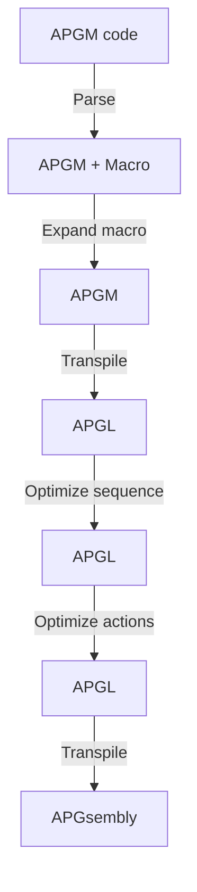

# APGM

APGsembly macro language

APGM is a language created to output APGsembly. It uses structured programming
and macros.

[APGM - APGsembly macro language](https://rei1024.github.io/apgm/)

## Pipeline

## Development

### Requirements

- Node.js (see `.node-version`)
- npm

### Usage

- `$ npm run dev` Local development server
- `$ npm run test` Unit tests with Vitest
- `$ npm run test:watch` Unit tests with file watcher
- `$ npm run coverage` Unit tests coverage
- `$ npm run build` Build for production with Vite
- `$ npm run preview` Preview production build
- `$ npm run spell` Spell check with cspell
